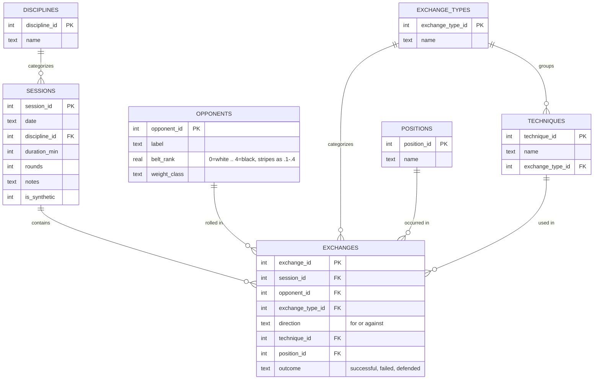

# Combat Sports Training Intelligence

A personal analytics pipeline for BJJ/MMA training: sessions and individual
exchanges (submissions, takedowns, sweeps, escapes) land in a normalized
SQLite database, get aggregated with hand-written SQL, get pattern-checked
with Python, and surface as a Power BI dashboard.

Built as a portfolio project — the priority is a clean, defensible,
end-to-end pipeline (schema → SQL → Python → BI) over any single flashy
feature.

## Problem

Generic fitness trackers count reps, minutes, and calories. None of that
tells a grappler anything useful. The questions that actually matter —
*Which position am I getting submitted from most? Is my takedown success
rate actually improving, or does it just feel that way? Am I only losing to
higher belts, or across the board?* — require event-level data: what
happened, from where, against whom, with what result. A step counter can't
answer any of that. This project treats a training session the way it
should be treated: as a sequence of discrete, categorizable exchanges, not
a single blob of "60 minutes, felt tough."

## Solution

A normalized schema instead of a flat spreadsheet:

- **`sessions`** — one row per training session (date, discipline,
  duration, rounds).
- **`exchanges`** — one row per notable event *within* a session
  (submission/takedown/sweep/escape, for/against, technique, position,
  outcome). This is the table that makes the data queryable at all.
- **`opponents`** — belt rank (numeric, stripes as decimals) and weight
  class, so performance can be segmented by who you were rolling with.
- **`positions`, `techniques`, `exchange_types`, `disciplines`** — lookup
  tables. `position` and `technique` are controlled vocabulary, not free
  text, on purpose: free text breaks every `GROUP BY` the moment "half
  guard" and "Half Guard" and "halfguard" get logged as three different
  values.



**Pipeline layers:**

1. **Schema** — [`schema.sql`](schema.sql), enforced via SQLite foreign
   keys and `CHECK` constraints.
2. **SQL analysis** — hand-written `.sql` files in [`sql/`](sql/) that do
   the actual aggregation (rolling weekly rates, position breakdowns, belt
   segmentation, volume) directly in the database, not in pandas.
3. **Python pattern-finding** — [`analysis/trend_analysis.py`](analysis/trend_analysis.py)
   runs a weighted linear regression over the weekly SQL output to quantify
   trend claims, and flags positions with a notably high finish-rate using a
   plain proportion comparison (not an over-engineered model for a
   ~65-session dataset). [`analysis/insights.py`](analysis/insights.py)
   turns those into plain-language strings, every one of which states its
   sample size.
4. **Power BI** — see [`powerbi/SETUP.md`](powerbi/SETUP.md) for the build
   recipe against the exported CSVs.
5. **Web dashboard** — [`web/index.html`](web/index.html) is a standalone,
   dependency-free front end (hand-rolled SVG charts, no charting library)
   reading the same data as a static snapshot in [`web/data.js`](web/data.js).
   Open `web/index.html` directly in a browser, or serve the folder
   (`python -m http.server 8000` from `web/`) — no build step. Refresh the
   arrays in `data.js` from `exports/*.csv` after logging real sessions.

## Outcome

Example insights the pipeline surfaced from the current (synthetic —
see note below) dataset of 65 sessions / 683 exchanges:

> **Takedown success rate increased by 35.2 percentage points over 22
> weeks (~33.3% → ~50.0%), based on 96 takedown attempts.**
> The weighted regression in `trend_analysis.py` weights each week by its
> attempt count specifically so that a 1-attempt week (which can swing
> 0%→100%) doesn't dominate the slope the way it would in an unweighted fit.

> **Back accounts for 28.7% of submissions conceded (27 of 44 total).**
> By a wide margin the single biggest identifiable leak — a real training
> log with this pattern would point straight at back-defense as the next
> thing to drill.

> **Submissions conceded from mount are finished at a 62.5% rate, +15.7
> points above the 46.8% average across all positions (n=8).**
> Flagged by the position-notability check — n=8 is thin, so this reads as
> "worth watching," not "proven," which is exactly the caveat the insight
> is supposed to carry.

Re-run `python analysis/insights.py` any time the data changes; the exact
numbers above will drift as more sessions are logged.

## Real vs. synthetic data provenance

Every row in `sessions` carries an `is_synthetic` flag. The dataset
currently in `db/training.db` was produced entirely by
[`scripts/generate_synthetic_data.py`](scripts/generate_synthetic_data.py)
— **it is not real training history.** It exists to prototype and
demonstrate the pipeline before enough real sessions accumulate to analyze.
The generator deliberately bakes in a few trends (rising takedown success
rate, a disproportionate submission-conceded rate from the `back` position,
worse performance against higher belts) so the SQL/Python layers have
something real to find — see the docstring at the top of that script for
the exact mechanics. Log real sessions with `scripts/log_session.py`, which
inserts with `is_synthetic = 0`; every query and export in this project can
be filtered on that column to separate the two.

## Setup

```bash
python -m venv .venv
source .venv/Scripts/activate   # or .venv/bin/activate on macOS/Linux
pip install -r requirements.txt

# 1. Create the database
python scripts/init_db.py

# 2. Populate it — pick one or both:
python scripts/generate_synthetic_data.py --seed 42 --sessions 65   # synthetic
python scripts/log_session.py                                      # real, interactive CLI

# 3. Run the analysis layer
python analysis/sql_runner.py        # raw SQL query output
python analysis/trend_analysis.py    # regression + position flags
python analysis/insights.py          # plain-language insight strings
python analysis/exploratory_plots.py # sanity-check plots -> exports/plots/

# 4. Export for Power BI
python scripts/export_for_powerbi.py # -> exports/*.csv
```

Then follow [`powerbi/SETUP.md`](powerbi/SETUP.md) to build the dashboard
in Power BI Desktop against `exports/*.csv`.

### Windows note

If you hit `DLL load failed ... filename or extension is too long` when
importing `matplotlib`/`PIL`, it's a Windows `MAX_PATH` issue caused by a
deeply nested project directory, not a code problem — create the virtualenv
somewhere shallower (e.g. `C:\venvs\combat-sports-intel`) and re-install.

## Project layout

```
schema.sql                        normalized schema + lookup table seeds
scripts/
  init_db.py                      create/reset the SQLite database
  db_utils.py                     shared connection + vocab-lookup helpers
  log_session.py                  interactive CLI for logging a real session
  generate_synthetic_data.py      synthetic data generator (~65 sessions)
  export_for_powerbi.py           dump analysis + raw tables to exports/*.csv
sql/
  takedown_trend.sql              rolling weekly takedown success rate
  submission_conceded_by_position.sql
  performance_by_belt.sql
  session_volume.sql
analysis/
  sql_runner.py                   loads/runs the .sql files, returns DataFrames
  trend_analysis.py               regression slope + position-notability flags
  insights.py                     plain-language insight strings (with N)
  exploratory_plots.py            matplotlib/seaborn sanity-check plots
powerbi/
  SETUP.md                        dashboard build recipe
exports/                          generated CSVs + plots (gitignored)
db/                                generated SQLite file (gitignored)
```
