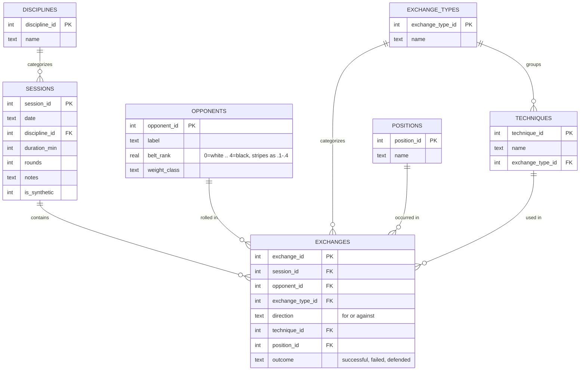

# Combat Sports Training Intelligence

A personal analytics pipeline for BJJ/MMA training: sessions and individual
exchanges (submissions, takedowns, sweeps, escapes) land in a normalized
SQLite database, get aggregated with hand-written SQL, get pattern-checked
with Python, and surface as a Power BI dashboard.

Built as a portfolio project — the priority is a clean, defensible,
end-to-end pipeline (schema → SQL → Python → BI) over any single flashy
feature.

## Problem

Generic fitness trackers count reps, minutes, and calories. None of that
tells a grappler anything useful. The questions that actually matter —
*Which position am I getting submitted from most? Is my takedown success
rate actually improving, or does it just feel that way? Am I only losing to
higher belts, or across the board?* — require event-level data: what
happened, from where, against whom, with what result. A step counter can't
answer any of that. This project treats a training session the way it
should be treated: as a sequence of discrete, categorizable exchanges, not
a single blob of "60 minutes, felt tough."

## Solution

A normalized schema instead of a flat spreadsheet:

- **`sessions`** — one row per training session (date, discipline,
  duration, rounds).
- **`exchanges`** — one row per notable event *within* a session
  (submission/takedown/sweep/escape, for/against, technique, position,
  outcome). This is the table that makes the data queryable at all.
- **`opponents`** — belt rank (numeric, stripes as decimals) and weight
  class, so performance can be segmented by who you were rolling with.
- **`positions`, `techniques`, `exchange_types`, `disciplines`** — lookup
  tables. `position` and `technique` are controlled vocabulary, not free
  text, on purpose: free text breaks every `GROUP BY` the moment "half
  guard" and "Half Guard" and "halfguard" get logged as three different
  values.



**Pipeline layers:**

1. **Schema** — [`schema.sql`](schema.sql), enforced via SQLite foreign
   keys and `CHECK` constraints.
2. **SQL analysis** — hand-written `.sql` files in [`sql/`](sql/) that do
   the actual aggregation (rolling weekly rates, position breakdowns, belt
   segmentation, volume) directly in the database, not in pandas.
3. **Python pattern-finding** — [`analysis/trend_analysis.py`](analysis/trend_analysis.py)
   runs a weighted linear regression over the weekly SQL output to quantify
   trend claims, and flags positions with a notably high finish-rate using a
   plain proportion comparison (not an over-engineered model for a
   ~65-session dataset). [`analysis/insights.py`](analysis/insights.py)
   turns those into plain-language strings, every one of which states its
   sample size.
4. **Power BI** — see [`powerbi/SETUP.md`](powerbi/SETUP.md) for the build
   recipe against the exported CSVs.
5. **Web dashboard** — [`web/index.html`](web/index.html) is a standalone,
   dependency-free front end (hand-rolled SVG charts, no charting library)
   reading the same data as a static snapshot in [`web/data.js`](web/data.js).
   Open `web/index.html` directly in a browser, or serve the folder
   (`python -m http.server 8000` from `web/`) — no build step. Refresh the
   arrays in `data.js` from `exports/*.csv` after logging real sessions.

## Outcome

Example insights the pipeline surfaced from the current (synthetic —
see note below) dataset of 65 sessions / 683 exchanges:

> **Takedown success rate increased by 35.2 percentage points over 22
> weeks (~33.3% → ~50.0%), based on 96 takedown attempts.**
> The weighted regression in `trend_analysis.py` weights each week by its
> attempt count specifically so that a 1-attempt week (which can swing
> 0%→100%) doesn't dominate the slope the way it would in an unweighted fit.

> **Back accounts for 28.7% of submissions conceded (27 of 44 total).**
> By a wide margin the single biggest identifiable leak — a real training
> log with this pattern would point straight at back-defense as the next
> thing to drill.

> **Submissions conceded from mount are finished at a 62.5% rate, +15.7
> points above the 46.8% average across all positions (n=8).**
> Flagged by the position-notability check — n=8 is thin, so this reads as
> "worth watching," not "proven," which is exactly the caveat the insight
> is supposed to carry.

Re-run `python analysis/insights.py` any time the data changes; the exact
numbers above will drift as more sessions are logged.

## Real vs. synthetic data provenance

Every row in `sessions` carries an `is_synthetic` flag. The dataset
currently in `db/training.db` was produced entirely by
[`scripts/generate_synthetic_data.py`](scripts/generate_synthetic_data.py)
— **it is not real training history.** It exists to prototype and
demonstrate the pipeline before enough real sessions accumulate to analyze.
The generator deliberately bakes in a few trends (rising takedown success
rate, a disproportionate submission-conceded rate from the `back` position,
worse performance against higher belts) so the SQL/Python layers have
something real to find — see the docstring at the top of that script for
the exact mechanics. Log real sessions with `scripts/log_session.py`, which
inserts with `is_synthetic = 0`; every query and export in this project can
be filtered on that column to separate the two.

## Setup

```bash
python -m venv .venv
source .venv/Scripts/activate   # or .venv/bin/activate on macOS/Linux
pip install -r requirements.txt

# 1. Create the database
python scripts/init_db.py

# 2. Populate it — pick one or both:
python scripts/generate_synthetic_data.py --seed 42 --sessions 65   # synthetic
python scripts/log_session.py                                      # real, interactive CLI

# 3. Run the analysis layer
python analysis/sql_runner.py        # raw SQL query output
python analysis/trend_analysis.py    # regression + position flags
python analysis/insights.py          # plain-language insight strings
python analysis/exploratory_plots.py # sanity-check plots -> exports/plots/

# 4. Export for Power BI
python scripts/export_for_powerbi.py # -> exports/*.csv
```

Then follow [`powerbi/SETUP.md`](powerbi/SETUP.md) to build the dashboard
in Power BI Desktop against `exports/*.csv`.

### Film Room app

A small Flask app for reviewing footage: upload a clip, or (on a phone) film a
roll live and get coaching cues while you record. The Anthropic key stays on
the server; the browser only talks to `/api/*`.

```bash
export ANTHROPIC_API_KEY=sk-ant-...          # or: ant auth login
export APP_TOKEN=choose-a-long-access-code   # required, at least 12 characters
python app/server.py                          # http://127.0.0.1:5000
```

The server will not start without `APP_TOKEN`. Log in with that code in the
browser. The session cookie lasts 12 hours, and repeated wrong codes block
further attempts for 15 minutes.

- **Upload film** samples frames from a clip in the browser and sends them for
  review. If "Keep this video" is checked, the clip is also stored privately on
  the server so you can replay it and jump to any frame timestamp in the report.
- **Live camera** (phones and tablets only) samples a frame every 8 seconds,
  shows a one-line cue from the last three frames, and on "Stop and review"
  sends eight evenly spaced frames for a full review.
- Every review is saved to the `film_reviews` table and listed under "Past reviews".

**Disciplines.** Every review is written for one sport, chosen in the page
(or with `--discipline` in the command-line script): Boxing, Kickboxing, Muay
Thai, MMA, or Brazilian Jiu-Jitsu. Each sport has its own instructions, its own
evidence categories, and a list of claims it must not make. A boxing report
cannot use a grappling category, and the server rejects a model response that
does. The criteria live in `app/disciplines.py`.

**Insufficient evidence.** A report can say that the frames cannot support a
judgment. Its evidence status is then "limited" or "insufficient", with an
explanation, and the findings, priorities, and drills are left empty. Two
synthetic test clips without an athlete produced this result.

**Cache keys.** A stored report is reused only when the discipline, model,
report version, and discipline instruction version all match, along with the
frame times, frame contents, and note. Editing a discipline's instructions
changes its version, so older reports are not reused.

**Command-line review.**

```bash
python scripts/analyze_film.py path/to/clip.mp4 --discipline boxing
```

**Structured reports.** Each review returns JSON with a summary, observations
(each cites frame numbers and carries an Observed, Inferred, or Uncertain
label), technical findings grouped by area, corrective drills, up to three
top priorities, and a sampling caveat. The server checks every frame reference
against the frames it actually sent, and drops references that don't match.
Priorities and drills appear only when the footage supports them.

**Adaptive sampling.** The browser takes one frame per 8 seconds of clip,
with at least 4 and at most 16 frames. A 20-second clip gets 4 frames, a
2-minute clip gets 15, and a 5-minute clip gets 16, spaced about 19 seconds
apart. Frame times travel with the frames, so every frame shown in a report
maps to a real moment in the clip.

**Cost.** Each review makes one Claude call. Identical requests (same frames,
times, and note) are answered from the stored report with no API call. Measured
on this machine: a 4-frame review used 3,407 input and 593 output tokens, about
$0.013 at Sonnet 5.5 rates ($2 / $10 per million). Rough estimates, not yet
measured on real footage: about $0.02 for 8 frames, $0.03 for 16 frames, and
about $0.005 per live cue. A malformed report is retried once, which can double
the cost of that one review.

Settings, in addition to the table below:

| Variable | Default | Purpose |
|---|---|---|
| `REVIEW_MAX_FRAMES` | `16` | Frame cap per review (1 to 24) |
| `REVIEW_MIN_FRAMES` | `4` | Frame floor per review |
| `FRAME_INTERVAL_SECONDS` | `8` | Target spacing between frames |

**Phase 3 security notes.** Login and the access check run before every API route.
Failed logins are counted before the code is checked, so guessing is limited.
State-changing requests must carry the `X-Film-Room` header. Session tokens are
stored only as hashes. Video responses are marked `no-store`. The server refuses
to start without a strong access code.

**Known limits.** There is one operator and one access code, not user accounts.
Videos are not encrypted by the app, so rely on full-disk encryption. The
decoder reads uploaded files with OpenCV, so only log in from devices you trust.

**Tests.**

```bash
pip install -r requirements-dev.txt
python -m pytest                       # 303 tests, no network, mocked Claude (real-file checks run when paths are set)
RUN_LIVE_API=1 python -m pytest tests/test_live_api.py -s   # one real API call
```

**Database migrations.** The app upgrades the database on startup.
`app/migrations.py` tracks progress in `PRAGMA user_version`. Existing reviews
are kept, and a failed step rolls back.

Settings (environment variables):

| Variable | Default | Purpose |
|---|---|---|
| `CLAUDE_MODEL` | `claude-sonnet-5-5` | Model used for reviews and cues |
| `APP_TOKEN` | required | Access code (at least 12 characters). Every API call needs a session from logging in |
| `VIDEO_RETENTION_DAYS` | `7` | Days before a kept video is deleted |
| `VIDEO_MAX_MB` | `500` | Largest accepted upload |
| `VIDEO_MAX_SECONDS` | `1800` | Longest accepted clip (30 minutes) |
| `FILM_ROOM_STORAGE` | `./storage` | Private video directory (git-ignored) |
| `FILM_ROOM_COOKIE_SECURE` | unset | Set to `1` when served over HTTPS |
| `RATE_LIMIT_PER_MIN` | `20` | Requests per client IP per minute |
| `HOST` / `PORT` | `127.0.0.1` / `5000` | Bind address |

**Video storage and privacy.** Kept videos are stored under `storage/videos/`
with random file names. That directory is outside the web root and has no URL.
The only way to read a video is the authenticated media route, which checks the
session and the owner. Each video is deleted 7 days after upload, by an hourly
sweep and whenever the video list is read. You can delete a video at any time.
Its report stays in history, but its playback link is removed.

Uploads are accepted only as MP4 or MOV, and only if the file has a valid
container header, is at most 500 MB and 30 minutes long, and decodes. Clips
using codecs browsers cannot play (for example MPEG-4 Part 2 or Motion JPEG)
are refused, with a message to re-export as H.264. HEVC (iPhone) footage is
accepted, but whether a browser can play it depends on the device.

**Compatibility (tested here).** Tested in Chrome on Windows with real files:

| Format | Result |
|---|---|
| H.264 MP4 (`avc1`), 1080x1920, 15 s | Uploads, plays, seeks, pauses and resumes, changes speed, samples frames |
| HEVC (`hvc1`) MOV from an iPhone, 2160x3840, 49.7 s | Uploads, plays, samples frames |
| H.264 MOV | Not verified. The only H.264 MOV available is 692 MB, over the 500 MB limit |
| Other browsers (Firefox, Safari, Android) | Not verified |

Clips using MPEG-4 Part 2 (`mp4v`) or Motion JPEG are refused with a message to
re-export as H.264. HEVC plays only where the browser can decode it.

**Athlete selection.** Type a description such as "the fighter wearing white."
The report then states how many sampled frames show the athlete, and lists them,
as a count taken from the frames rather than from the model's wording. Each
frame is judged on its own, and the report never claims continuous tracking.
If the athlete is identified in fewer than two frames, or cannot be followed,
the report withholds every observation, finding, drill, and priority for them
and shows a warning instead.

**Deleting reports.** Each report has a Delete button. It asks for confirmation,
and removes only that report. Deleting every report requires typing
`DELETE ALL REPORTS`. Neither action touches stored videos. Deleting a video
keeps its reports but removes their playback links.

**Timestamps.** Each frame reference in a report is a button that moves the
player to that frame's time in the clip. Times come only from the sampled frames
and are never extrapolated.

**Live camera needs HTTPS** on a phone: browsers only grant camera access to
`localhost` or a secure origin. To test on your phone, expose the server through
an HTTPS tunnel, or deploy it behind HTTPS. If you deploy it publicly, set
`APP_TOKEN` so strangers can't spend your API credits. The rate limiter keys on
the client IP, which behind a tunnel is the tunnel's address, so it becomes a
shared limit for everyone using that tunnel.

### Training analytics

The **Training** view (top bar) summarizes saved reports only. Every number is computed from the reports you have saved, not from the footage again. Nothing here measures athletic performance or shows improvement.

Counting rules (also shown in the app under "How counts work"):

- A session is one saved report. Repeating a cached request does not create one.
- Only observed and inferred findings count. Uncertain findings are never counted.
- Several findings in one category within one session count as one session.
- **Detected across multiple sessions**: detected in at least 2 sessions.
- **Detected across multiple sessions and days**: detected in at least 3 sessions on at least 2 calendar days.
- **Not detected**: nothing was detected in a session that assessed the area. This is not evidence the area is fixed.
- A session counts as having assessed an area only when its report recorded that area. Reports saved before REPORT_VERSION 6 did not record this, so for them "not detected" is unknown and is never counted as clear.

Views:

- **Overview**: saved sessions by sport and date range.
- **Detected across multiple sessions**: categories that meet the rules above.
- **Recurring issues**: every category with its counts, observed and inferred split, and status. A category filter is available.
- **Compare**: two sessions from the same sport. Categories are grouped as detected in both, detected only in the earlier session, detected only in the newer session, assessed in both but not detected, or cannot be compared. Each category is marked comparable or "interpret with care", with the reasons (limited evidence, athlete not confirmed, different athlete named, sampled spans or clip lengths that differ). Links open each report and its clip at the frame concerned.
- **Drill library**: drills recommended by saved reports in the current filters, with the findings they address. Each drill's findings come from the reports that recommend it.
- **Practice history**: days you logged practicing a drill. A log records that a day happened. It is not evidence that technique improved. Entries survive report deletion and show whether a saved report still recommends the drill.
- **History**: search by text, category, drill, recurring issues and date, with paging. Open, compare and delete are available for each session.

Limits:

- Footage quality is not scored. Each report samples a few frames, so anything between frames is not assessed.
- A pattern across saved reports is a pattern in the records, not a diagnosis. The same clip analysed twice counts as two sessions.
- Practice logs record your own days. A drill appears in the library only while a saved report in scope recommends it.
- The Training view is tested with automated tests and checked by hand in the built-in browser at 375 px and 1280 px. Other browsers are not tested.

Routes (all require login; changes also require the `X-Film-Room` header): `GET /api/analytics/dashboard`, `GET /api/analytics/issues`, `GET /api/analytics/compare`, `GET /api/analytics/drills`, `GET /api/drill-practice`, `POST /api/drill-practice`, `DELETE /api/drill-practice/<id>`, `GET /api/history`, `GET /api/reviews/<id>`.

Database: schema version 5 adds normalized finding, drill and practice tables, and a `judged_areas_json` column on reports. Upgrading from version 4 keeps every report. The upgrade from version 4 was rehearsed on a copy, checked row by row against the stored reports, and applied only after a verified backup.

### AI film review (command line)

```bash
export ANTHROPIC_API_KEY=sk-ant-...          # console.anthropic.com
python scripts/analyze_film.py path/to/clip.mp4
python scripts/analyze_film.py path/to/clip.mp4 --frames 12 --session-id 7
```

Samples a handful of frames from a video clip and sends them to a
vision-capable Claude model for qualitative coaching notes (position, base,
grips, structural issues). **This is not automatic event detection** — a
sparse frame sample can't reliably identify fast transitions or name exact
techniques, and the prompt tells the model to say so rather than guess.
Reviews save to `film_reviews/*.md` (gitignored — real footage notes aren't
portfolio content by default); `--session-id` also appends the review to
that session's `notes` field in the database.

### Windows note

If you hit `DLL load failed ... filename or extension is too long` when
importing `matplotlib`/`PIL`, it's a Windows `MAX_PATH` issue caused by a
deeply nested project directory, not a code problem — create the virtualenv
somewhere shallower (e.g. `C:\venvs\combat-sports-intel`) and re-install.

## Project layout

```
schema.sql                        normalized schema + lookup table seeds
scripts/
  init_db.py                      create/reset the SQLite database
  db_utils.py                     shared connection + vocab-lookup helpers
  log_session.py                  interactive CLI for logging a real session
  generate_synthetic_data.py      synthetic data generator (~65 sessions)
  export_for_powerbi.py           dump analysis + raw tables to exports/*.csv
  analyze_film.py                 AI-assisted film review (frame sampling + Claude vision)
app/
  server.py                       Flask backend: /api/review, /api/live-cue, /api/reviews
  static/                         Film Room front end (index.html, app.js, app.css)
sql/
  takedown_trend.sql              rolling weekly takedown success rate
  submission_conceded_by_position.sql
  performance_by_belt.sql
  session_volume.sql
analysis/
  sql_runner.py                   loads/runs the .sql files, returns DataFrames
  trend_analysis.py               regression slope + position-notability flags
  insights.py                     plain-language insight strings (with N)
  exploratory_plots.py            matplotlib/seaborn sanity-check plots
powerbi/
  SETUP.md                        dashboard build recipe
exports/                          generated CSVs + plots (gitignored)
db/                                generated SQLite file (gitignored)
film_reviews/                     AI film review notes (gitignored)
```
